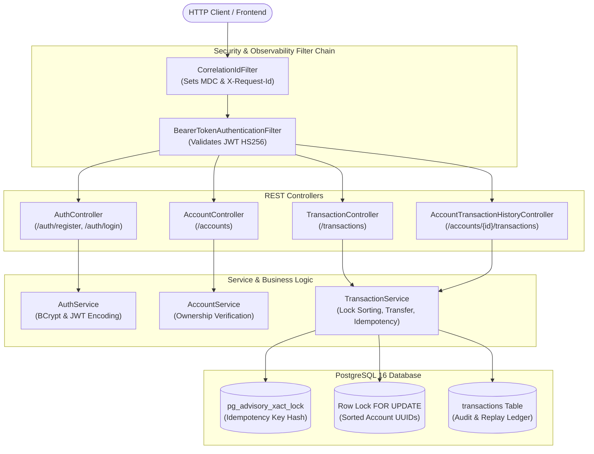

# Concurrent-Safe Transaction Backend

[](https://openjdk.org/)
[](https://spring.io/projects/spring-boot)
[](https://www.postgresql.org/)
[](https://www.docker.com/)
[]()

A high-reliability financial transfer engine engineered to guarantee **zero balance corruption, zero double-spending, and deadlock-free execution under extreme concurrency**.

---

## 1. The Core Engineering Problem

In distributed banking systems, concurrent transfer requests against the same account introduce severe data integrity risks:

```
Thread A: Read Alice ($1000) ──> Deduct $100 ──────────────> Write Alice ($900)  [LOST UPDATE!]
Thread B: Read Alice ($1000) ───────> Deduct $200 ──> Write Alice ($800)
```

Without rigorous concurrency controls, race conditions result in **lost updates**, **negative balances**, or **deadlocks** when transfers occur simultaneously in opposite directions (e.g., Alice $\to$ Bob and Bob $\to$ Alice).

This project solves these challenges using **PostgreSQL row-level locking with deterministic order acquisition**, **transaction-scoped advisory locks for idempotency**, and **stateless JWT authorization**.

---

## 2. System Architecture



---

## 3. Concurrency & Integrity Mechanisms

### A. Deterministic Lock Ordering (Deadlock Prevention)
When Alice transfers to Bob simultaneously while Bob transfers to Alice:
- Without sorting: Thread 1 locks Alice and waits for Bob; Thread 2 locks Bob and waits for Alice $\implies$ **Deadlock**.
- **Our Solution:** The service compares account UUIDs and always locks in strict ascending order:
  $$\text{FirstLock} = \min(\text{UUID}_A, \text{UUID}_B), \quad \text{SecondLock} = \max(\text{UUID}_A, \text{UUID}_B)$$
  Both threads acquire row locks in the exact same sequence via `SELECT ... FOR UPDATE`, converting deadlock into safe serial execution.

### B. Idempotency via Transaction-Level Advisory Locks
Network retries often cause clients to duplicate transfer requests.
1. The request provides an `Idempotency-Key` header.
2. The service acquires a PostgreSQL transaction-scoped advisory lock using `hashtextextended(:idempotencyKey, 0)`.
3. If an audit record with this key already exists:
   - Same parameters $\implies$ Replay original transaction (**HTTP 200 OK** without transferring again).
   - Different parameters $\implies$ Reject conflict (**HTTP 409 Conflict**).
4. If first seen $\implies$ Execute transfer, persist audit row, release lock at `COMMIT` (**HTTP 201 Created**).

### C. Single-Transaction Atomicity
Account balance mutations and transaction audit record creation execute in the exact same `@Transactional` boundary. If insufficient funds or runtime exceptions occur, the transaction aborts and rolls back completely—money cannot be deducted without an audit trail.

---

## 4. Empirical Benchmark: Pessimistic vs. Optimistic Locking

We conducted empirical benchmarking under high contention (100 concurrent threads attempting transfers on the same account simultaneously).

| Metric | Pessimistic Locking (`SELECT FOR UPDATE`) | Optimistic Locking (`@Version`) |
| :--- | :--- | :--- |
| **Strategy** | Threads queue on row lock; serial execution | Fail-fast on stale version conflict |
| **Total Transfers Attempted** | 100 | 100 |
| **Successful Transfers** | **100 / 100 (100.0%)** | **7 / 100 (7.0%)** |
| **Conflicts / Failures** | **0** | **93** (`ObjectOptimisticLockingFailureException`) |
| **Total Duration** | 521 ms | 148 ms |
| **Money Conserved** | **100.0% ($1,000.00)** | **100.0% ($1,000.00)** |

### Engineering Trade-Off Analysis
- **Pessimistic Locking** is optimal for hot financial accounts. Although latency is slightly higher due to queue wait time, throughput is 100% reliable without wasting CPU cycles on application-level retries.
- **Optimistic Locking** is ideal for low-contention scenarios (e.g., editing user profiles). Under hot-account money transfers, 93% of requests fail fast, requiring aggressive retry loops that degrade database performance.
- **Invariant:** Both strategies maintain 100% mathematical conservation of money.

---

## 5. End-to-End HTTP Load Testing

Executed using our standalone concurrent test harness against the containerized backend over HTTP:

```text
=== Concurrent Load Test: 50 transfers across 10 concurrent HTTP workers ===
Total Requests:     50
Successful (201):   50 (100.0%)
Failed Requests:    0 (0.0%)
Total Duration:     0.37 s
Throughput:         133.99 req/sec
Average Latency:    65.74 ms
p95 Latency:        134.51 ms
Sender Balance:     $500.00
Receiver Balance:   $500.00
Total Conserved:    $1000.00 (100.0% conserved)
```

---

## 6. Authentication, Authorization & Security

1. **Password Hashing:** Passwords are never stored in plaintext. Hashed with **BCrypt** ($10$ rounds).
2. **Stateless JWT:** Tokens signed with **HMAC-SHA256** (`HS256`) with a 1-hour expiration time.
3. **Domain Ownership Enforcement:**
   - **Account Viewing:** Users can only query accounts they own. Cross-account snooping returns `403 Forbidden`.
   - **Transfer Origination:** Users can only transfer out of accounts they own. Transfers to any destination account remain permitted.
   - **Transaction History:** Account history access is restricted to the verified account owner.
4. **Request Correlation:** `CorrelationIdFilter` captures incoming `X-Request-Id` or issues a UUID, populating SLF4J `MDC` for distributed tracing and structured log aggregation.

---

## 7. API Reference

### Authentication
- `POST /auth/register` — Register a new user (`email`, `password`).
- `POST /auth/login` — Authenticate and obtain JWT Bearer token.

### Accounts (Protected)
- `POST /accounts` — Open an account (`ownerName`, `initialBalance`).
- `GET /accounts` — List all accounts owned by the authenticated user.
- `GET /accounts/{id}` — Fetch account balance (Owner only).
- `GET /accounts/{id}/transactions?page=0&size=10` — Paginated account transaction history (Owner only).

### Transactions (Protected)
- `POST /transactions` — Execute idempotent money transfer:
  - Header: `Idempotency-Key: <unique-uuid>`
  - Body: `{"fromAccountId": "...", "toAccountId": "...", "amount": 100.00}`
  - Returns `201 Created` on first execution, `200 OK` on idempotency replay.

---

## 8. React & TypeScript Frontend

A high-performance, responsive React 19 + TypeScript web application (`transaction-frontend`) demonstrating full-stack integration:

1. **Authentication:** User registration and JWT login with automatic Bearer token injection.
2. **Account Management:** Open accounts and view real-time ledger balances.
3. **Safe Transfers:** Transfer funds with auto-generated UUID idempotency keys and visual replay indicators.
4. **Audit History:** Paginated, server-side transaction ledger.
5. **Interactive Concurrency Stress Test:** Trigger parallel bidirectional transfers directly from the browser with `Promise.all`, verifying money conservation ($1,000 initial = $1,000 final) in real-time.

### Running the Frontend
```bash
cd transaction-frontend
npm install
npm run dev
```
Open **`http://localhost:5173`** in your browser.

---

## 9. Interview Preparation & Resume Portfolio

Comprehensive technical documentation tailored for software engineering interviews:

- 📖 **[Agoda Interview Preparation Guide](docs/agoda-interview-prep.md):** 10 deep-dive Q&As covering pessimistic locking trade-offs, deadlock prevention math, advisory locking vs. Redis, MVCC internals, and distributed scaling patterns.
- 🎯 **[Resume Accomplishment Bullets](docs/resume-accomplishments.md):** Google XYZ-formatted accomplishment statements (`Accomplished [X] as measured by [Y], by doing [Z]`) and technical keywords ready for resume integration.

---

## 10. Verification & Running Locally

### Prerequisites
- Docker Desktop
- Node.js (v18+)
- Java 21 & Maven Wrapper (included)

### Running the Application
```bash
# 1. Start PostgreSQL and Backend in Docker
docker compose up --build -d

# 2. Run the automated HTTP load test
python3 scripts/load_test.py

# 3. Launch the Frontend
cd transaction-frontend && npm run dev
```

### Running the Integration Test Suite
The test suite utilizes **Testcontainers** to spin up an isolated, disposable PostgreSQL 16 container:
```bash
export JWT_SECRET=$(openssl rand -base64 32)
./transaction-backend/mvnw -f transaction-backend/pom.xml test
```
All **45 integration tests** (concurrency, locking, idempotency, authorization, and filters) pass with zero errors.
