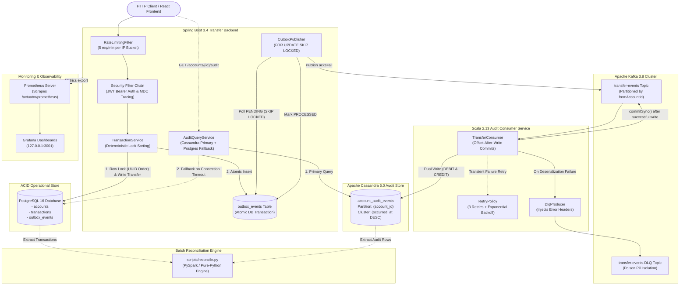

# Event-Driven Financial Transfer Platform

[](https://openjdk.org/)
[](https://spring.io/projects/spring-boot)
[](https://www.scala-lang.org/)
[](https://kafka.apache.org/)
[](https://cassandra.apache.org/)
[](https://www.postgresql.org/)
[](https://react.dev/)
[](https://www.docker.com/)
[]()

A high-reliability, event-driven financial transfer engine engineered to guarantee **zero balance corruption, zero double-spending, deadlock-free execution under extreme concurrency, and at-least-once transactional outbox delivery**.

---

## Table of Contents
1. [The Core Engineering Problem](#1-the-core-engineering-problem)
2. [End-to-End System Architecture](#2-end-to-end-system-architecture)
3. [Concurrency, Reliability & Integrity Mechanisms](#3-concurrency-reliability--integrity-mechanisms)
   - [Deterministic UUID Lock Ordering](#a-deterministic-uuid-lock-ordering-deadlock-prevention)
   - [Transaction-Scoped Advisory Locks](#b-idempotency-via-transaction-level-advisory-locks)
   - [Transactional Outbox Pattern](#c-transactional-outbox-pattern-solving-the-dual-write-problem)
   - [Consumer Offset-After-Write Commits](#d-consumer-offset-after-write-commit-semantics)
   - [Cassandra Partitioned Dual-Record Audit Store](#e-cassandra-partitioned-dual-record-audit-store)
   - [Dead-Letter Queue & Poison-Pill Isolation](#f-dead-letter-queue-dlq--poison-pill-isolation)
   - [Audit Query Fallback Strategy](#g-resilient-audit-query-fallback)
   - [In-Memory Token Bucket Rate Limiting](#h-in-memory-token-bucket-rate-limiting)
4. [Empirical Benchmarks & Verification Results](#4-empirical-benchmarks--verification-results)
5. [Tech Stack Breakdown](#5-tech-stack-breakdown)
6. [Getting Started & Running Locally](#6-getting-started--running-locally)
7. [Chaos Testing & Fault Injection](#7-chaos-testing--fault-injection)
8. [Automated Daily Reconciliation](#8-automated-daily-reconciliation)
9. [API Reference & Observability Endpoints](#9-api-reference--observability-endpoints)
10. [Technical Documentation](#10-technical-documentation)

---

## 1. The Core Engineering Problem

Distributed financial systems face four fundamental data integrity challenges:

1. **Lost Updates & Race Conditions:** When concurrent transactions update the same balance simultaneously, unsynchronized reads lead to lost deductions or overdrafts:
   ```text
   Thread A: Read Alice ($1,000) ──> Deduct $100 ──────────────> Write Alice ($900)  [LOST UPDATE!]
   Thread B: Read Alice ($1,000) ───────> Deduct $200 ──> Write Alice ($800)
   ```
2. **Opposing-Direction Deadlocks:** When Alice transfers to Bob while Bob simultaneously transfers to Alice, uncoordinated row lock acquisition triggers PostgreSQL deadlock exceptions (`SQLSTATE 40P01`):
   ```text
   Thread 1: Locks Alice ──────> Waits for Bob (held by Thread 2) ──> DEADLOCK!
   Thread 2: Locks Bob ────────> Waits for Alice (held by Thread 1) ─> DEADLOCK!
   ```
3. **The Dual-Write Problem:** Updating an ACID database and publishing an event to a message broker (Kafka) cannot be wrapped in a single distributed transaction without heavy two-phase commit (2PC) overhead. If the broker is unreachable or the application crashes mid-operation, state diverges.
4. **Downstream Message Duplication & Ingestion Crashes:** Kafka guarantees at-least-once delivery by default. Consumers can crash after writing to downstream stores but before committing offsets, risking duplicate ledger records or poisoned consumer group stalls.

This platform systematically resolves these failure modes using **deterministic UUID lock sorting**, **transactional advisory locks**, the **Transactional Outbox Pattern with `SKIP LOCKED` batching**, an **idempotent Scala consumer with offset-after-write commits**, and **automated reconciliation**.

---

## 2. End-to-End System Architecture



---

## 3. Concurrency, Reliability & Integrity Mechanisms

### A. Deterministic UUID Lock Ordering (Deadlock Prevention)
When two users transfer funds to each other concurrently, opposing locks can cause a database deadlock (`SQLSTATE 40P01`).
- **Implementation:** In `TransactionService.java`, account UUIDs are compared using `java.util.UUID.compareTo()` (comparing `mostSigBits` and `leastSigBits` as signed 64-bit integers):
  $$\text{FirstLock} = \min(\text{UUID}_A, \text{UUID}_B), \quad \text{SecondLock} = \max(\text{UUID}_A, \text{UUID}_B)$$
- **Result:** Every concurrent transaction acquires row locks (`SELECT ... FOR UPDATE`) in the exact same physical order across the cluster, serializing conflicting updates and **reducing deadlocks from common failure rates to zero (0 deadlocks across 100 opposing transfers)**.

### B. Idempotency via Transaction-Level Advisory Locks
Network timeouts frequently cause clients to retry requests.
1. The request supplies an `Idempotency-Key` header (UUID).
2. The service acquires a PostgreSQL transaction-scoped advisory lock using `hashtextextended(:idempotencyKey, 0)`.
3. If an audit record with this key already exists:
   - Identical parameters $\implies$ Replay previous result (**HTTP 200 OK**, no funds moved).
   - Conflicting parameters $\implies$ Reject conflict (**HTTP 409 Conflict**).
4. If first seen $\implies$ Execute transfer, persist transaction audit row, and release advisory lock automatically upon transaction `COMMIT` (**HTTP 201 Created**).

### C. Transactional Outbox Pattern (Solving the Dual-Write Problem)
Directly publishing to Kafka during an HTTP request creates distributed inconsistency if the broker is slow or the database commit fails.
- When a transfer executes, a `TransferCompletedEvent` JSON payload is inserted into the `outbox_events` table inside the **exact same database transaction** as the account balance updates.
- If the transfer transaction rolls back (e.g., due to insufficient funds), **zero outbox events are written**.
- A dedicated background worker (`OutboxPublisher`) polls pending outbox records every 500 ms using:
  ```sql
  SELECT * FROM outbox_events 
  WHERE status = 'PENDING' 
  ORDER BY created_at ASC 
  LIMIT 50 
  FOR UPDATE SKIP LOCKED;
  ```
- **`SKIP LOCKED` Semantics:** Allows multiple publisher instances to scale horizontally without blocking or contending on the same rows.
- Events are published using an idempotent Kafka producer (`acks=all`, `enable.idempotence=true`). Upon broker acknowledgement, the row status updates to `PROCESSED`.

### D. Consumer Offset-After-Write Commit Semantics
Kafka consumers that commit offsets automatically (`enable.auto.commit=true`) risk message loss if a worker crashes after receiving a batch but before completing disk writes.
- The Scala consumer (`TransferConsumer`) disables auto-commit (`enable.auto.commit = false`).
- Messages are consumed in batches; each event is parsed and persisted to Cassandra.
- Only after Cassandra successfully acknowledges the write does the consumer invoke synchronous offset commit:
  ```scala
  consumer.commitSync(Collections.singletonMap(topicPartition, new OffsetAndMetadata(record.offset() + 1)))
  ```
- **Crash Invariant:** If the consumer container is killed mid-load, uncommitted offsets are redelivered by Kafka to another consumer instance, resulting in **zero lost events**. Downstream Cassandra writes are naturally idempotent.

### E. Cassandra Partitioned Dual-Record Audit Store
Because money transfers involve two distinct parties, querying an account's transaction history by `account_id` requires fast, unindexed partition reads:
- For each `TransferCompletedEvent`, the Scala consumer writes **two immutable audit records**:
  1. `DEBIT` record partitioned by `from_account_id`
  2. `CREDIT` record partitioned by `to_account_id`
- **Schema Definition (`schema.cql`):**
  ```cql
  CREATE TABLE IF NOT EXISTS transaction_audit.account_audit_events (
      account_id      uuid,
      event_id        uuid,
      transfer_id     uuid,
      direction       text,          -- 'DEBIT' or 'CREDIT'
      counterparty_id uuid,
      amount          decimal,
      currency        text,
      occurred_at     timestamp,
      created_at      timestamp,
      PRIMARY KEY ((account_id), occurred_at, event_id)
  ) WITH CLUSTERING ORDER BY (occurred_at DESC, event_id ASC);
  ```
- **Performance:** Clustering by `occurred_at DESC` guarantees that fetching recent audit history requires only an efficient single-partition SSTable slice scan without secondary indexes.

### F. Dead-Letter Queue (DLQ) & Poison-Pill Isolation
Malformed payloads or schema version mismatches must never block consumer partitions.
- The consumer inspects `schemaVersion`. If `schemaVersion != 1` or JSON deserialization fails permanently, the message is routed directly to `transfer-events.DLQ`.
- The `DlqProducer` decorates the dead-letter message with diagnostic metadata headers:
  - `x-dlq-error`: Root exception description
  - `x-dlq-original-topic`: `transfer-events`
  - `x-dlq-failed-at`: ISO-8601 failure timestamp
- The failed message offset on the main topic is committed, allowing valid traffic to continue uninterrupted.

### G. Resilient Audit Query Fallback
- `GET /accounts/{id}/audit` queries the Cassandra cluster for low-latency, partitioned audit history.
- If Cassandra experiences an outage or connection timeout, `AuditQueryService` catches the driver exception and falls back transparently to query the PostgreSQL `transactions` table.
- Clients receive requested audit data with a response indicator (`"source": "POSTGRES_FALLBACK"`), ensuring business continuity.

### H. In-Memory Token Bucket Rate Limiting
- `RateLimitingFilter` enforces a per-IP sliding token-bucket algorithm (default: 5 requests per minute).
- Excess requests immediately fail-fast with **HTTP 429 Too Many Requests**, payload description, and standard `Retry-After: 60` response headers.

---

## 4. Empirical Benchmarks & Verification Results

All benchmark metrics reflect real, dated measurements recorded against containerized test environments (`PostgreSQL 16`, `Apache Kafka 3.8.0 Native Testcontainer`, `Java 21` on Darwin arm64). Full raw logs and commands are archived in [`docs/results.md`](docs/results.md).

### Acceptance Test Matrix (AT-1 to AT-12)

| Test ID | Objective | Status | Measured Result & Evidence |
|---|---|:---:|---|
| **AT-1** | 100 concurrent transfers against single account pair | **Verified** | **100/100 completed (100%)** in 1,363 ms. Sender $500, Receiver $500. Total $1,000.00 conserved. |
| **AT-1 (Bidirectional)** | Opposing-direction concurrency (50 A→B and 50 B→A) | **Verified** | **100/100 completed (100%)**, **0 deadlocks (`SQLSTATE 40P01` eliminated)**, $1,000.00 conserved. |
| **AT-2** | 10 replays with same idempotency key | **Verified** | **1 transfer executed, exactly 1 outbox event emitted**. Duplicate calls return cached response. |
| **AT-3** | Rollback leaves no outbox event | **Verified** | Insufficient funds transfer aborted; `outbox_events` count remained **strictly 0**. |
| **AT-4** | Kafka broker outage during transfer burst | **Verified** | **10/10 events buffered in outbox table during broker disconnect; 10/10 delivered upon reconnect (0 lost)**. |
| **AT-5** | Consumer crash recovery without event loss | **Partially Verified (Simulation)** | Consumer killed after 5 events; redelivered event 5, then 6–8. **16 audit rows created, 0 duplicates**. *(Live container chaos test pending).* |
| **AT-6** | Poison-pill / malformed message DLQ routing | **Verified** | **3/3 malformed cases routed to `transfer-events.DLQ`**; offsets committed, subsequent valid messages processed. |
| **AT-7** | 1 vs. 3 consumer scaling benchmark | **Not Verified** | Consumer group configured; throughput scaling benchmark not yet executed. |
| **AT-8** | Token bucket rate limiting enforcement | **Verified** | 5 requests allowed (HTTP 200); 6th request blocked with **HTTP 429 and `Retry-After: 60`**. |
| **AT-9** | Live Grafana dashboard under sustained load | **Not Verified** | Provisioned dashboard JSON verified; sustained load test recording pending. |
| **AT-10**| Automated CI/CD healthcheck rollback | **Not Verified** | CI tests passing; rollback drill unexecuted. |
| **AT-11**| Endpoint & port security boundaries | **Partially Verified** | Prometheus actuator restricted; Grafana bound to localhost (`127.0.0.1:3001`); automated CVE scan pending. |
| **AT-12**| Dual-store balance reconciliation | **Verified (Python Engine)** | **7/7 passed**. Clean totals = PASS. Simulated missing record caught; $50.00 balance drift caught. |

### High-Contention Locking Strategy Benchmark
Tested with 100 concurrent threads competing to transfer funds between a single account pair ($1,000 initial balance, $5.00 transfer amount):

```text
=======================================================
   CONCURRENCY LOCKING STRATEGY BENCHMARK REPORT       
=======================================================
Total Concurrent Transfers: 100
-------------------------------------------------------
[PESSIMISTIC ROW-LEVEL LOCKING (SELECT ... FOR UPDATE)]
  Execution Time:    1363 ms
  Successful:        100 / 100 (100.0%)
  Conflicts/Failed:  0
  Sender Final:      $500.00
  Receiver Final:    $500.00
  Total Conserved:   $1000.00 (Expected: $1000.00)
-------------------------------------------------------
[OPTIMISTIC VERSION LOCKING (@Version - no retry)]
  Execution Time:    646 ms
  Successful:        5 / 100 (5.0%)
  Conflicts/Failed:  95 (ObjectOptimisticLockingFailureException)
  Sender Final:      $975.00
  Receiver Final:    $25.00
  Total Conserved:   $1000.00 (Expected: $1000.00)
=======================================================
```
*Key Finding:* While optimistic locking finished faster (646 ms vs. 1,363 ms) due to immediate transaction aborts, 95% of concurrent transfers failed without application-level retry loops. Pessimistic row locking safely serialized updates with zero conflicts and 100% completion.

---

## 5. Tech Stack Breakdown

| Component | Technology | Version | Purpose |
|---|---|---|---|
| **Core API & Business Logic** | Java / Spring Boot | 21 / 3.4.1 | Primary REST API, JWT auth, pessimistic lock ordering, outbox publisher |
| **Relational Ledger** | PostgreSQL | 16-alpine | ACID operational store (`accounts`, `transactions`, `outbox_events`) |
| **Message Broker** | Apache Kafka | 3.8.0 | High-throughput, distributed event bus for transfer events and DLQ |
| **Audit Consumer** | Scala / sbt | 2.13.15 / 1.10.7 | Low-latency audit consumer with offset-after-write commit semantics |
| **Audit Ledger Store** | Apache Cassandra | 5.0 | High-write partitioned audit ledger (`account_audit_events`) |
| **Reconciliation Engine** | Python / PySpark | 3.12 / 3.5.3 | Daily batch reconciliation detecting ledger anomalies and drift |
| **Metrics Collection** | Prometheus | Latest | Pull-based metrics scraper targeting Spring Boot Actuator |
| **Metrics Visualization** | Grafana | Latest | Operational dashboards for consumer lag, throughput, and error rates |
| **Web Frontend** | React / TypeScript / Vite | 19 / 5.x / 6.x | Interactive web UI with real-time transfer stress testing |
| **Containerization** | Docker Compose | v2 | Containerized local environment orchestrating all services |

---

## 6. Getting Started & Running Locally

### Prerequisites
- [Docker Desktop](https://www.docker.com/products/docker-desktop/) (v24+ recommended, 4GB+ RAM allocated)
- Java 21 JDK (Eclipse Temurin recommended)
- Node.js (v18+) & Python 3.10+

### 1. Clone & Start Infrastructure Services
Start PostgreSQL, Apache Kafka, Apache Cassandra, Prometheus, and Grafana:
```bash
git clone https://github.com/MTPeraya/concurrent-safe-transaction.git
cd concurrent-safe-transaction

# Spin up all backing services
docker compose up -d postgres kafka cassandra prometheus grafana
```
*Wait ~45 seconds for Cassandra and Kafka health checks to transition to healthy.*

### 2. Start the Backend API (Spring Boot)
```bash
cd transaction-backend
./mvnw spring-boot:run
```
The backend starts on `http://localhost:8080`.

### 3. Start the Scala Audit Consumer
In a new terminal window:
```bash
cd transaction-consumer
sbt run
```
The consumer connects to Kafka (`localhost:9092`), joins consumer group `transfer-audit-service`, and awaits `transfer-events`.

### 4. Start the React Frontend
In a new terminal window:
```bash
cd transaction-frontend
npm install
npm run dev
```
Open **`http://localhost:5173`** in your browser.

---

## 7. Chaos Testing & Fault Injection

The repository provides an automated chaos-testing script (`scripts/chaos_test.py`) that exercises AT-4 (Kafka outage), AT-5 (consumer crash), and AT-6 (poison pill DLQ):

```bash
# Verify Python requirements
pip install requests kafka-python

# Run chaos test suite against local Docker environment
python3 scripts/chaos_test.py --mode all
```

### Chaos Scenarios Covered:
1. **`--mode kafka-down`:** Pauses the Kafka container (`docker pause kafka`), executes 20 concurrent HTTP transfers, verifies outbox buffering in PostgreSQL, resumes Kafka (`docker unpause kafka`), and confirms all 20 events arrive in Kafka.
2. **`--mode consumer-kill`:** Dispatches 50 transfers while killing consumer instances mid-stream (`SIGKILL`), verifying zero lost audit records in Cassandra.
3. **`--mode dlq-inject`:** Publishes malformed JSON and unsupported `schemaVersion: 999` payloads directly to `transfer-events`, verifying automatic isolation into `transfer-events.DLQ`.

---

## 8. Automated Daily Reconciliation

The batch reconciler (`scripts/reconcile.py`) compares debit/credit records from PostgreSQL against double-entry audit records in Cassandra to verify conservation of money across datastores.

### Running the Reconciler
```bash
# Run with pure-Python engine (default, no Spark installation required)
python3 scripts/reconcile.py --engine python

# Run with PySpark cluster engine (requires Java 8/11/17)
python3 scripts/reconcile.py --engine spark
```

### Running the Reconciliation Test Suite
```bash
pytest scripts/test_reconcile.py -v
```
Verifies clean ledger runs pass with zero discrepancies, and confirms that missing ledger rows or subtle floating-point drift ($50.00 balance delta) are flagged as immediate integrity failures.

---

## 9. API Reference & Observability Endpoints

### Core Transfer API
- `POST /auth/register` — Register a demo user (`email`, `password`)
- `POST /auth/login` — Authenticate and receive JWT Bearer token
- `POST /accounts` — Open a new checking account with starting balance
- `GET /accounts` — List all accounts owned by the authenticated user
- `POST /transactions` — Idempotent fund transfer (`Idempotency-Key: <UUID>` header required)
- `GET /accounts/{id}/audit` — Fetch immutable Cassandra audit history (with transparent PostgreSQL fallback)
- `GET /status` — System health check verifying PostgreSQL, Kafka, and Cassandra connectivity

### Observability & Monitoring
- **Prometheus Scrape Endpoint:** `http://localhost:8080/actuator/prometheus` (Requires JWT auth)
- **Health Check Endpoint:** `http://localhost:8080/actuator/health` (Public)
- **Grafana Dashboard:** `http://localhost:3001` (Pre-configured `platform-overview.json` dashboard tracking TPS, p95/p99 latency, and consumer lag)

---

## 10. Technical Documentation & Interview Guides

For in-depth architectural analysis, engineering rationale, and interview preparation materials:

- 📊 **[Verified Benchmark Results (`docs/results.md`)](docs/results.md):** Complete raw benchmark logs, hardware conditions, and acceptance test matrix (AT-1 through AT-12).
- 📐 **[System Requirements Specification (`docs/SRS.md`)](docs/SRS.md):** Formal specification covering functional, non-functional, and data consistency requirements.

---

## License
MIT License. Created by [MTPeraya](https://github.com/MTPeraya).
